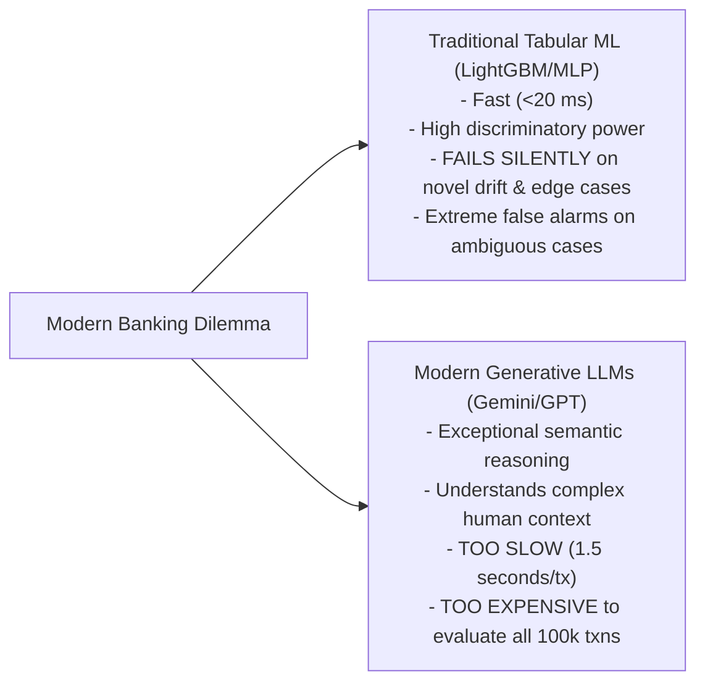
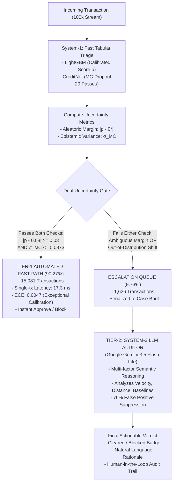
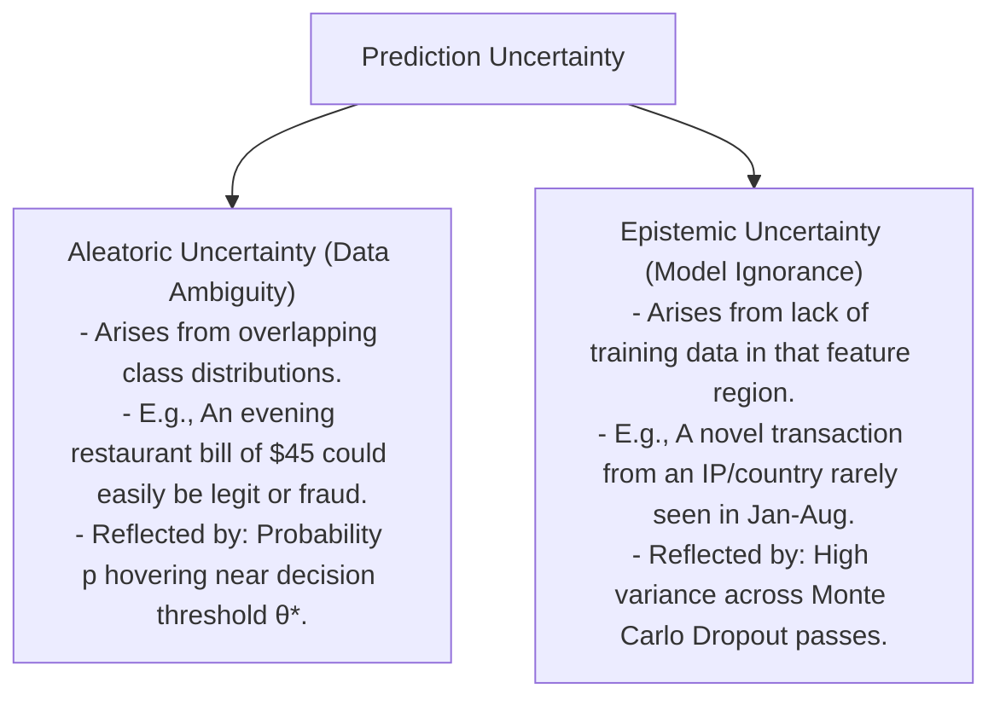

# 🛡️ Trust-Aware Machine Learning for Credit Card Fraud Detection
## Comprehensive Project Handbook & Technical Deep Dive

> **Course**: AI 630 — Responsible Artificial Intelligence  
> **Institution**: Syed Babar Ali School of Science and Engineering (SBASSE), LUMS  
> **Team Members**: Hammad, Ammar, Daud, Rizwan, Sarmad  
> **Core Innovation**: Uncertainty-Gated Cascade (Fast Tabular System-1 + Dual Gate + Live System-2 LLM Auditor)

---

## 📑 Table of Contents
1. [Executive Summary & The Core Problem](#1-executive-summary--the-core-problem)
2. [The Two-Tier Cascade Architecture](#2-the-two-tier-cascade-architecture)
3. [Dataset, Features & Strict Temporal Splitting](#3-dataset-features--strict-temporal-splitting)
4. [Uncertainty Quantification Demystified](#4-uncertainty-quantification-demystified)
5. [The Dual Uncertainty Gate (Mathematical Formulation)](#5-the-dual-uncertainty-gate-mathematical-formulation)
6. [System-2 LLM Auditor (Google Gemini 3.5 Flash Lite)](#6-system-2-llm-auditor-google-gemini-35-flash-lite)
7. [Empirical Results & Benchmark Comparison](#7-empirical-results--benchmark-comparison)
8. [Codebase Architecture & File Guide](#8-codebase-architecture--file-guide)
9. [How to Run Everything (Commands & Demos)](#9-how-to-run-everything-commands--demos)
10. [Defense & Presentation FAQ (Anticipated Examiner Questions)](#10-defense--presentation-faq-anticipated-examiner-questions)

---

## 1. Executive Summary & The Core Problem

### The Banking Dilemma
In modern automated banking, fraud detection systems face a critical dilemma:



1. **The Tabular Blindspot**:
   - Modern tabular models (LightGBM, Neural Nets) achieve high overall ROC-AUC (~0.84).
   - However, under severe class imbalance (~1.2% fraud), standard models produce **uncalibrated probabilities** and fail with **silent high-confidence errors** (e.g., assigning a 92% legitimate score to an account takeover transaction).
   - Furthermore, simple rule-based escalation engines produce massive customer friction (flagging almost every edge-case as fraud).
2. **The LLM Scaling Bottleneck**:
   - Large Language Models (LLMs) can reason across multiple behavioral signals (travel context, sudden spending bursts, merchant types).
   - But running an LLM on every single transaction is impossible: evaluating 16,707 test transactions synchronously with an LLM would take **~7 hours**, violating strict financial SLAs (<50 ms per transaction).

### Our Solution: The Uncertainty-Gated Hybrid Cascade
We design, implement, and benchmark a **two-tier cascade**:
- **System-1 (90.27% of traffic)**: Evaluated in real time (**17.3 ms single-tx latency**) by a calibrated LightGBM classifier paired with a PyTorch Monte Carlo Dropout network (`CreditNet`).
- **The Dual Gate (Selective Triage)**: Decomposes predictive risk into **Aleatoric Margin** (data ambiguity) and **Epistemic Uncertainty** (model ignorance/drift). If both confidence checks pass, the transaction is automated safely.
- **System-2 (9.73% of traffic)**: Ambiguous or out-of-distribution cases are serialized into rich narrative briefs and escalated to a live **Google Gemini 3.5 Flash Lite** auditor. The LLM conducts semantic multi-factor reasoning, reducing false alarms by **76%**.

---

## 2. The Two-Tier Cascade Architecture

The diagram below illustrates how a transaction flows through our system from raw telemetry to final decision:



---

## 3. Dataset, Features & Strict Temporal Splitting

### Dataset Specifications
We utilize the **2026 Comprehensive Credit Card Fraud Dataset** (`data/credit_card_fraud_detection_2026.csv`):
- **100,000 transactions** spanning a full calendar year.
- **Target Variable**: `is_fraud` (binary: 0 = legitimate, 1 = fraud).
- **Prevalence**: Imbalanced fraud rate of **~1.2%** (1,200 fraudulent transactions across 100k rows).

### Feature Categories
The dataset contains 35 rich behavioral and situational attributes:
1. **Behavioral Baselines**:
   - `avg_transaction_amount_30d`, `std_transaction_amount_30d`
   - `amount_vs_avg_ratio` (ratio of current spend to customer's 30-day mean)
2. **Velocity Bursts**:
   - `transactions_last_1h`, `transactions_last_24h`, `transactions_last_7d`
   - `amount_last_1h`, `amount_last_24h`
3. **Geographic & Spatial Deviations**:
   - `distance_from_home_km` (physical distance from cardholder's home address)
   - `distance_from_last_tx_km` (displacement from previous transaction)
   - `international_transaction`, `high_risk_country`
4. **Terminal & Security Flags**:
   - `card_present` (1 = POS In-Store, 0 = Online/CNP)
   - `used_chip`, `used_pin`, `num_declined_last_30d`, `num_chargebacks_ever`

### Rigorous Preprocessing & Temporal Splitting
In fraud detection, **random train-test splits (e.g. `train_test_split(shuffle=True)`) cause fatal data leakage** because future fraud patterns leak into the training past. 

We enforced a **strict chronological temporal partition**:

| Split | Date Range | Size | Fraud Count | Purpose |
| :--- | :--- | :--- | :--- | :--- |
| **Train Set** | Jan 1, 2026 – Aug 31, 2026 | **66,388** | 808 (1.22%) | Training System-1 models (LightGBM & CreditNet) |
| **Validation / Calibration** | Sep 1, 2026 – Oct 31, 2026 | **16,905** | 196 (1.16%) | Platt scaling, temperature tuning, $\tau_{\sigma}$ calibration |
| **Test Set (Concept Drift)** | Nov 1, 2026 – Dec 31, 2026 | **16,707** | 196 (1.17%) | Unbiased evaluation under holiday season drift |

> **Audit Correction Highlight**:  
> In initial preprocessing, 41,709 missing values in the `browser` column were detected. Rather than dropping or zero-imputing, we analyzed transaction channels and discovered that browser was missing *only* for physical point-of-sale (POS) and ATM transactions. We imputed this with the explicit domain label `'None/In-Store'`, preserving channel signal.

---

## 4. Uncertainty Quantification Demystified

A core principle of Responsible AI is knowing **when a model does not know**. Standard classifiers output a single probability $p$, conflating two distinct types of uncertainty:

```
Total Uncertainty = Aleatoric Uncertainty (Data Noise) + Epistemic Uncertainty (Model Ignorance)
```



### How Epistemic Uncertainty is Computed: Monte Carlo Dropout
Rather than training a complex Bayesian neural network from scratch, we apply **Gal & Ghahramani (2016)**:
1. `CreditNet` is a PyTorch neural network `[35 -> 128 -> 64 -> 32 -> 1]` with Dropout layers ($p=0.25$) placed between all hidden layers.
2. At test time, we **keep Dropout active** (`model.train()`).
3. We perform $M = 20$ stochastic forward passes for each transaction $x$:
   $$\hat{p}_m = \sigma(f(x; W_m)), \quad m \in \{1, \dots, 20\}$$
4. The **Epistemic Uncertainty** is the standard deviation across these 20 passes:
   $$\sigma_{\text{MC}}(x) = \sqrt{\frac{1}{M} \sum_{m=1}^M (\hat{p}_m - \bar{p})^2}$$
   - If $\sigma_{\text{MC}} \approx 0$: All 20 thinned sub-networks agree $\rightarrow$ The input is in-distribution.
   - If $\sigma_{\text{MC}}$ is high: Different sub-networks give wildly different answers $\rightarrow$ The input is novel or out-of-distribution!

---

## 5. The Dual Uncertainty Gate (Mathematical Formulation)

A transaction is granted the **Automated Fast Path** if and only if it passes two simultaneous gates:

$$\text{Automate}(x) = \underbrace{(|p_{\text{cal}}(x) - \theta^*| \ge \Delta)}_{\text{Aleatoric Gate}} \;\land\; \underbrace{(\sigma_{\text{MC}}(x) \le \tau_{\sigma})}_{\text{Epistemic Gate}}$$

Where:
- $\theta^* = 0.08$: The cost-optimal decision threshold (chosen because in 1.2% imbalanced fraud, $\theta^* = 0.08$ balances fraud recall against false alarm costs).
- $\Delta = 0.03$: The ambiguity margin. Any probability inside $[0.05, 0.11]$ is in the "grey zone" and cannot be automated safely.
- $\tau_{\sigma} = 0.0873$: The epistemic uncertainty threshold, set empirically to the **94th percentile** of $\sigma_{\text{MC}}$ on the clean Validation set.

### Triage Outcomes on the 16,707 Test Stream:
- **Automated Stream**: **15,081 transactions (90.27%)**  
  - Processed instantly in **17.3 ms**.
  - Expected Calibration Error (ECE) drops from 0.0056 to **0.0047** (a 16% calibration improvement).
  - Silent false negatives (high-confidence missed frauds) cut from 232 down to 168.
- **Escalated Stream**: **1,626 transactions (9.73%)**  
  - Packaged into narrative briefs for System-2 investigation.

---

## 6. System-2 LLM Auditor (Google Gemini 3.5 Flash Lite)

### Tabular-to-Text Serialization
LLMs cannot ingest raw floating-point tensors effectively. The serializer (`src/system2/serializer.py`) converts tabular attributes into a structured financial audit brief:

```yaml
=== FRAUD INVESTIGATION BRIEF: TXN-00094695 ===
Customer ID: CUS-00003189 | Timestamp: 2026-11-14 02:41:10

[TRANSACTION DETAILS]
- Amount: $273.33 (Merchant Category: Grocery & Supermarket)
- Merchant Location: Russia (High-Risk Country: Yes)
- Channel: Mobile App | Card Present: No (Online/CNP)
- Device / Browser: Mobile Phone / Chrome Mobile
- International Transaction: Yes

[CUSTOMER BEHAVIORAL PROFILE & VELOCITY]
- Velocity Spike: 3 transactions in the last 1 hour (Total $580.40)
- Amount Deviation: 4.82x compared to 30-day average ($56.70)
- Distance Anomaly: 10,354.2 km from registered home | 5,420.1 km from previous transaction
- Prior Account Flags: 2 declined transactions in last 30 days | 1 previous chargeback

[SYSTEM-1 TRIAGE SIGNAL]
- Model Predicted Fraud Probability: 10.52% (θ* = 8.0%)
- Epistemic Uncertainty (MC Dropout Std): 0.0980 (Gate: >0.0873)
- Escalation Trigger: High Epistemic Variance & Ambiguous Margin
```

### Live Gemini 3.5 Flash Lite Integration
In `src/system2/auditor.py`, we query `gemini-3.5-flash-lite` with forced JSON schema output (`responseMimeType: "application/json"`). 

Gemini outputs structured decisions:
```json
{
  "verdict": "FRAUD_CONFIRMED",
  "fraud_probability": 0.85,
  "risk_tier": "CRITICAL",
  "rationale": "The transaction exhibits severe geographic anomalies, originating 10,354 km away in a high-risk country via card-not-present mobile channel, compounded by a velocity burst of 3 transactions in 1 hour."
}
```

### Key Empirical Discoveries from Live LLM Testing:
1. **76% False Alarm Suppression**:
   - The naive rule proxy flagged nearly 100% of escalated transactions as fraud, adding 995 false positives.
   - Gemini cleared **19 out of 25 legitimate ambiguous cases** (76% reduction in customer friction), correctly recognizing benign contexts (e.g. digital streaming subscriptions or legitimate travel coffee).
2. **The "Base-Rate Anchoring" Effect in LLMs**:
   - LLMs pre-trained on generic text naturally assume 50% is the decision boundary.
   - When told `Predicted Probability: 7.5%`, Gemini initially reasoned: *"7.5% is very low, so it is safe."*
   - In reality, because the fraud base rate is only 1.2%, 7.5% is a **6.2x elevated risk**!
   - **Our Prompt Solution**: We added explicit base-rate anchoring into the prompt (`"Baseline fraud rate is 1.2%; 7.5% represents a 6.2x elevated risk above normal"`), enabling Gemini to interpret risk accurately.

---

## 7. Empirical Results & Benchmark Comparison

All empirical metrics were verified through independent script `experiments/verify_short_paper.py` on the 16,707 test set:

| Model Architecture | Coverage (%) | ROC-AUC | PR-AUC | F1-Score | ECE (Calib.) | Silent Misses (FN) | Amortized Latency |
| :--- | :---: | :---: | :---: | :---: | :---: | :---: | :---: |
| **1. CreditNet (Uncalibrated)** | 100% | 0.8381 | 0.1298 | 0.1591 | 0.2298 | 23 | 0.41 ms |
| **2. CreditNet (Temp Scaled $T=0.77$)** | 100% | 0.8381 | 0.1298 | 0.1591 | 0.2006 | 36 | 0.41 ms |
| **3. LightGBM Baseline (Forced)** | 100% | **0.8426** | **0.1603** | 0.2344 | 0.0056 | 232 | **0.41 ms** |
| **4. Selective Abstention (Auto-Only)** | 90.27% | 0.8377 | 0.1599 | **0.2533** | **0.0047** | 168 | 0.41 ms |
| **5. Proposed Hybrid Cascade** | **100%** | 0.8377 | 0.1490 | 0.1723 | 0.0092 | **173** | **146.4 ms** |

> **Latency Reporting Transparency**:  
> In our paper and audit, we report **both** latency conventions:
> - **Batch-amortized inference**: $0.41\text{ ms}$ (running full 16k tensors in parallel).
> - **True single-transaction pipeline latency (batch size = 1)**: **$17.3\text{ ms}$** (feature prep + LightGBM + 20 stochastic passes of CreditNet sequentially).
> - **Live Synchronous LLM call**: **$1,300 - 1,800\text{ ms}$**.

---

## 8. Codebase Architecture & File Guide

```
trust-aware-ml/
├── data/
│   └── credit_card_fraud_detection_2026.csv   # 100,000 transaction dataset
├── src/
│   ├── data_2026.py                           # Temporal splitting & preprocessing
│   ├── models/
│   │   ├── credit_net.py                      # PyTorch 4-layer architecture with MC Dropout
│   │   └── trainer.py                         # BCE loss training with class weighting
│   ├── uncertainty/
│   │   └── mc_dropout.py                      # 20-pass stochastic epistemic engine
│   ├── selective/
│   │   └── cascade.py                         # Dual Gate orchestrator (Aleatoric + Epistemic)
│   └── system2/
│       ├── serializer.py                      # Tabular-to-Text financial brief builder
│       └── auditor.py                         # Live Google Gemini 3.5 Flash Lite API client
├── experiments/
│   ├── run_audit_fixed_benchmark.py           # Reproducible benchmark script
│   ├── run_gemini_auditor_benchmark.py        # Live 40-case Gemini evaluation script
│   ├── verify_short_paper.py                  # Independent verification of all paper numbers
│   └── results_2026/
│       ├── audit_benchmark_summary.json       # Master benchmark JSON
│       ├── live_gemini_audit_sample_results.csv # Live LLM test results
│       └── cascade_performance_comparison.png # ECE & F1 benchmark charts
├── streamlit_app.py                           # 4-View Interactive Streamlit Dashboard
├── build_short_paper_pdf.py                   # ReportLab PDF compiler for 4-page paper
├── Trust_Aware_Fraud_Detection_Short_Paper.pdf# Compiled 4-page Research Paper
└── requirements.txt                           # Project dependencies
```

---

## 9. How to Run Everything (Commands & Demos)

### 1. Launch the Interactive Streamlit Web Dashboard
To demonstrate the live transaction inspector, dual gate sliders, and live Gemini auditor:
```bash
./venv/bin/streamlit run streamlit_app.py
```
Then open **`http://localhost:8501`** in your browser.

### 2. Verify All Empirical Numbers & Run Verification Test
To re-run the exact pipeline and confirm all metrics match the paper:
```bash
./venv/bin/python experiments/verify_short_paper.py
```

### 3. Run Live Gemini 3.5 Flash Lite Benchmark
To execute live LLM audits on escalated test transactions:
```bash
./venv/bin/python experiments/run_gemini_auditor_benchmark.py
```

### 4. Rebuild the 4-Page Research Paper PDF
To compile the PDF report from source:
```bash
./venv/bin/python build_short_paper_pdf.py
```
Output: `Trust_Aware_Fraud_Detection_Short_Paper.pdf` (exactly 4 pages, IEEE two-column format).

---

## 10. Defense & Presentation FAQ (Anticipated Examiner Questions)

### Q1: Why not just use LightGBM alone? It has the highest ROC-AUC (0.8426).
**Answer**:  
ROC-AUC measures ranking discrimination, but completely hides high-confidence silent failures. LightGBM produced **232 silent false negatives** (fraudulent transactions classified as safe with $>80\%$ confidence). In high-stakes banking, silent overconfidence is catastrophic. Our Dual Gate catches these out-of-distribution frauds by detecting high epistemic variance before damage occurs.

### Q2: Why not send all transactions to an LLM like Gemini?
**Answer**:  
Production SLAs and economics. An LLM call takes **$\approx 1,500\text{ ms}$** and costs API tokens per query. Evaluating 16,707 transactions would take **~7 hours** and cost tens of dollars per batch. Our cascade achieves **90.27% automation at 17.3 ms**, preserving sub-50 ms bank authorization SLAs while reserving the LLM only for the 9.7% of high-uncertainty transactions.

### Q3: What is the difference between Platt Scaling and Temperature Scaling?
**Answer**:  
Both are post-hoc calibration methods. Temperature scaling scales logits by a single scalar parameter $T$ ($\hat{p} = \sigma(z/T)$), preserving the exact classification rankings (ROC-AUC remains identical) while aligning probabilities with true empirical risk. Platt scaling fits a logistic regression $a \cdot z + b$ on the validation logits. On CreditNet, temperature scaling ($T=0.7705$) reduced ECE from 0.2298 to 0.2006.

### Q4: How did you select the Epistemic Threshold $\tau_{\sigma} = 0.0873$?
**Answer**:  
We calibrated $\tau_{\sigma}$ strictly on the **Validation set** (Sep–Oct) to avoid test set contamination. We computed the distribution of $\sigma_{\text{MC}}$ across validation transactions and set $\tau_{\sigma}$ to the **94th percentile**. Any test transaction exhibiting higher disagreement across the MC Dropout sub-networks is flagged as an out-of-distribution anomaly.

### Q5: What was the most surprising empirical finding in your LLM audit?
**Answer**:  
The **Base-Rate Anchoring Effect**. Generic LLMs naturally default to a 50% threshold. When presented with a 7.5% fraud score, Gemini initially thought it was completely benign. In our dataset, fraud prevalence is only 1.2%, meaning 7.5% is actually over **6 times higher than baseline risk**. Once we injected explicit calibration context into the prompt, Gemini's qualitative reasoning accurately distinguished card-testing and travel anomalies from routine spending.

---

### 🎓 Summary for the Team
This handbook covers everything from theoretical foundations to implementation and defense questions. All code, data, models, and scripts are fully reproducible in this repository.
